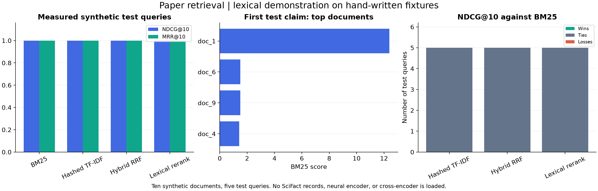

# Research Paper Semantic Search

> A reproducible SciFact benchmark for lexical, dense, hybrid, and cross-encoder reranked paper retrieval.


This project evaluates information retrieval over the BEIR SciFact corpus: 5,183 scientific documents and 1,109 claims with binary relevance judgments. It compares BM25, hashed TF-IDF, three sentence-transformer bi-encoders, weighted reciprocal rank fusion, and a cross-encoder reranker. All neural encoding and benchmark runs execute on Kaggle; local development uses a small offline fixture and CPU-safe components.

## Table of Contents

- [Features](#features)
- [Quickstart](#quickstart)
- [Installation](#installation)
- [CLI Reference](#cli-reference)
- [Python API](#python-api)
- [Evaluation and Methodology](#evaluation-and-methodology)
- [Results](#results)
- [Findings](#findings)
- [Reproduction](#reproduction)
- [Development and Testing](#development-and-testing)
- [Provenance](#provenance)
- [Reproducing the figure](#reproducing-the-figure)
- [License](#license)

## Features

- **Real BEIR SciFact loader**: pinned Hugging Face revisions, exact record-count and foreign-key validation, preserved document/query/qrel IDs.
- **Okapi BM25**: Robertson-Sparck Jones IDF with length normalization (k1=1.5, b=0.75).
- **Neural dense retrieval**: `SentenceTransformerRetriever` with normalized NumPy inner-product exact search and an optional FAISS `IndexFlatIP` backend verified for ranking parity.
- **Three bi-encoders**: all-MiniLM-L6-v2, BGE-base-en-v1.5 (with query instruction prefix), and allenai-specter for scientific text.
- **Hybrid RRF**: weighted reciprocal rank fusion tuned on a deterministic dev split.
- **Cross-encoder reranking**: `cross-encoder/ms-marco-MiniLM-L6-v2` over configurable candidate depths (20/50/100), plus an honest lexical-overlap baseline.
- **Statistics**: paired per-query bootstrap confidence intervals vs BM25 with win/tie/loss counts, and a `pytrec_eval` metric cross-check asserted to 1e-6 on the real run.

## Quickstart

Offline fixture comparison (no downloads, CPU only):

```bash
uv run paper-search compare
```

Query the fixture corpus:

```bash
uv run paper-search search "CRISPR Cas9 endonuclease cleavage" --system hybrid --top-k 5
```

The full neural benchmark runs on Kaggle; see [Reproduction](#reproduction).

## Installation

Core package (CPU-safe, no model downloads):

```bash
git clone https://github.com/Creator101-commits/research-paper-semantic-search.git
cd research-paper-semantic-search
uv sync
```

Neural extra for local experiments (downloads models on first use):

```bash
uv sync --extra neural
```

## CLI Reference

### 1. Version Check
```bash
uv run paper-search version
```

### 2. Search
Retrieve top results for any scientific claim or query:
```bash
uv run paper-search search "Lipid nanoparticles for mRNA delivery" --system rerank --top-k 3
```

Available systems: `bm25`, `tfidf` (hashed TF-IDF), `hybrid` (BM25 + hashed TF-IDF RRF), `rerank` (lexical overlap over hybrid candidates).

`--dataset` selects `fixture` (default, offline) or `scifact` (downloads BEIR SciFact from the Hugging Face Hub and requires the `neural` extra).

### 3. Benchmark Comparison (fixture)
```bash
uv run paper-search compare
uv run paper-search compare --dataset scifact
```

The SciFact path evaluates the CPU-safe systems; neural systems are evaluated by the Kaggle benchmark.

### 4. Full Markdown Report
```bash
uv run paper-search report --output artifacts/report.md
```

## Python API

```python
from paper_search.data.fixtures import load_fixture_benchmark
from paper_search.retrievers.bm25 import BM25Retriever
from paper_search.retrievers.hybrid import HybridRRFRetriever
from paper_search.reranking.reranker import LexicalOverlapReranker

# Offline fixture (10 docs, 7 queries)
data = load_fixture_benchmark()
docs = data.documents

hybrid = HybridRRFRetriever(k_rrf=60.0).index(docs)
candidates = hybrid.search("telomere attrition in cellular aging", k=20)

reranker = LexicalOverlapReranker()
reranker.index_documents(docs)
final_ranked, latency_ms = reranker.rerank(
    "telomere attrition in cellular aging",
    candidates,
    top_k=5,
)

for result in final_ranked:
    print(f"[{result.rank}] Doc {result.doc_id}: score={result.score:.4f}")
```

Neural retrievers (require the `neural` extra and download pinned model revisions):

```python
from paper_search.retrievers.dense import SentenceTransformerRetriever

retriever = SentenceTransformerRetriever(
    model_id="sentence-transformers/all-MiniLM-L6-v2",
    revision="1110a243fdf4706b3f48f1d95db1a4f5529b4d41",
    backends=("exact", "faiss"),
).index(docs)
results = retriever.search("CRISPR gene editing", k=10, backend="exact")
```

## Evaluation and Methodology

Metrics: NDCG@10, MAP@100, Recall@10, Recall@100, MRR@10, Precision@10.

Split policy:

- BEIR SciFact provides `train` (809 judged queries) and `test` (300 judged queries) qrels. BEIR's "test" split corresponds to the SciFact **development claims**; the official SciFact test labels are not public.
- A deterministic dev split is carved from the 809 train queries by SHA-256 ranking of `salt:query_id` (20%, salt `paper-search-dev-v1`), giving 162 dev queries. All tuning uses dev only.
- Tuned on dev: dense model for the hybrid arm, RRF constant k and fusion weights (grid search), and the rerank choice among {no rerank, CE depth 20, 50, 100}. The winning configuration is frozen before the single test evaluation; CE depths are still reported on test as ablations.
- Test evaluation reports each system once with paired bootstrap 95% CIs vs BM25 (1,000 resamples, seed 42) and per-query win/tie/loss counts.
- `pytrec_eval` cross-checks every test metric to 1e-6 agreement inside the Kaggle run.

## Results

Test split (300 queries), Tesla T4, kernel v13 @ c66cf51. The frozen final system is **`hybrid-rrf`** (no rerank; dev NDCG@10 0.7674 vs 0.7138/0.6962/0.6949 for CE depths 20/50/100):

| System | NDCG@10 | MAP@100 | Recall@10 | Recall@100 | P@10 | MRR@10 | Latency e2e (ms) |
| :--- | ---: | ---: | ---: | ---: | ---: | ---: | ---: |
| **`hybrid-rrf`** (frozen) | 0.7547 | 0.7101 | 0.8926 | 0.9693 | 0.1007 | 0.7168 | 29.0 |
| `dense-bge-base` | 0.7404 | 0.6978 | 0.8742 | 0.9667 | 0.0987 | 0.7034 | 17.1 |
| `hybrid+ce-rerank@20` (ablation) | 0.7109 | 0.6645 | 0.8628 | 0.9693 | 0.0963 | 0.6725 | 150.5 |
| `hybrid+ce-rerank@50` (ablation) | 0.6966 | 0.6565 | 0.8289 | 0.9693 | 0.0930 | 0.6640 | 305.1 |
| `hybrid+ce-rerank@100` (ablation) | 0.6902 | 0.6530 | 0.8122 | 0.9693 | 0.0913 | 0.6600 | 541.0 |
| `bm25` | 0.6643 | 0.6266 | 0.7816 | 0.8826 | 0.0867 | 0.6337 | 11.9 |
| `dense-minilm` | 0.6451 | 0.6031 | 0.7833 | 0.9250 | 0.0883 | 0.6047 | 11.5 |
| `hybrid+lexical-rerank` | 0.5165 | 0.4766 | 0.6675 | 0.9693 | 0.0730 | 0.4770 | 30.6 |
| `dense-specter` | 0.4788 | 0.4348 | 0.6373 | 0.8399 | 0.0723 | 0.4330 | 16.7 |
| `tfidf` | 0.1770 | 0.1578 | 0.2642 | 0.5083 | 0.0277 | 0.1517 | 1.2 |

Paired bootstrap vs BM25 on NDCG@10 (1,000 resamples, seed 42):

| Comparison | Mean delta NDCG@10 (95% CI) | Wins | Ties | Losses |
| :--- | :--- | ---: | ---: | ---: |
| `hybrid-rrf vs bm25` | +0.0903 [+0.0605, +0.1218] | 102 | 167 | 31 |
| `dense-bge-base vs bm25` | +0.0760 [+0.0401, +0.1133] | 93 | 162 | 45 |
| `hybrid+ce-rerank@20 vs bm25` | +0.0465 [+0.0152, +0.0778] | 72 | 177 | 51 |
| `hybrid+ce-rerank@50 vs bm25` | +0.0322 [-0.0007, +0.0634] | 66 | 181 | 53 |
| `hybrid+ce-rerank@100 vs bm25` | +0.0258 [-0.0086, +0.0573] | 65 | 182 | 53 |
| `dense-minilm vs bm25` | -0.0193 [-0.0563, +0.0173] | 66 | 161 | 73 |
| `hybrid+lexical-rerank vs bm25` | -0.1479 [-0.1859, -0.1100] | 35 | 155 | 110 |
| `dense-specter vs bm25` | -0.1856 [-0.2320, -0.1337] | 47 | 123 | 130 |
| `tfidf vs bm25` | -0.4873 [-0.5326, -0.4413] | 2 | 94 | 204 |

Additional paired comparisons (NDCG@10, same bootstrap):

| Comparison | Mean delta NDCG@10 (95% CI) | Wins | Ties | Losses |
| :--- | :--- | ---: | ---: | ---: |
| `hybrid-rrf vs dense-bge-base` (RQ3) | +0.0143 [+0.0003, +0.0281] | 42 | 226 | 32 |
| `hybrid+ce-rerank@20 vs hybrid-rrf` (RQ4) | -0.0438 [-0.0716, -0.0177] | 46 | 176 | 78 |
| `hybrid+ce-rerank@50 vs hybrid-rrf` (RQ4) | -0.0581 [-0.0879, -0.0302] | 44 | 175 | 81 |
| `hybrid+ce-rerank@100 vs hybrid-rrf` (RQ4) | -0.0645 [-0.0946, -0.0364] | 44 | 174 | 82 |

Latency is mean end-to-end ms/query on the Tesla T4 (first query excluded as warm-up): for reranked systems it includes the shared first-stage hybrid retrieval plus the rerank step. Rerank-stage-only means are 121.5 ms (@20), 276.2 ms (@50), 512.0 ms (@100), and 1.6 ms for the lexical reranker.

## Findings

Answers to the research questions in `PLAN.md`, all computed from the frozen test run above.

**RQ1: lexical vs dense for exact terminology and paraphrases.** BM25 (NDCG@10 0.6643) beats the hashed TF-IDF baseline by a wide margin (0.1770), outperforms two of the three pure dense encoders, and trails only BGE-base (0.7404). Per-query analysis over pure systems only (hybrids and rerankers are excluded because they all consume BM25 candidates): 7 test queries are solved only by BM25, meaning every pure dense encoder scores NDCG@10 = 0, while 39 are solved only by at least one pure dense encoder with BM25 at 0. Head-to-head, BM25 beats BGE-base on 10 queries to BGE-base's 35. Dense retrieval still handles paraphrase-style claims better overall on this corpus, but BM25 has a real niche of exact-terminology wins, and it remains the cheapest strong first stage and half of the winning hybrid.

**RQ2: scientific-domain vs compact general encoder.** The scientific encoder did not win: SPECTER scores 0.4788 NDCG@10 versus 0.6451 for all-MiniLM-L6-v2 and 0.7404 for BGE-base. This held on the dev split used for selection (BGE-base won the grid), so the result is not a test-split artifact. One plausible explanation is that SciFact claims are short sentences while SPECTER was trained on citation contexts; that is a hypothesis, not something this benchmark isolates.

**RQ3: does hybrid fusion improve recall without unacceptable cost?** Yes on quality: hybrid-rrf is the best system at 0.7547 NDCG@10 and ties for the best Recall@100 (0.9693), beating its dense arm by +0.0143 NDCG@10 with a 95% CI that excludes zero. The cost is modest: 29.0 ms/query end-to-end versus 17.1 ms for BGE alone and 11.9 ms for BM25, at the price of maintaining two indexes. Whether that trade is acceptable is a deployment decision; on quality alone fusion wins.

**RQ4: cross-encoder reranking at depths 20/50/100.** Reranking reduced quality at every depth on both dev (0.7674 to 0.7138/0.6962/0.6949) and test (vs hybrid-rrf: -0.0438, -0.0581, -0.0645, all CIs excluding zero), which is why dev selection froze `rerank_depth: null`. Deeper cuts cost more latency (150.5 to 541.0 ms e2e) for still-worse quality. A likely cause is domain shift: `ms-marco-MiniLM-L-6-v2` was trained on web passage ranking, not scientific claim verification; this benchmark does not prove that, but the consistent dev+test direction supports it as a hypothesis worth testing with a scientific reranker.

**RQ5: queries hard for every approach.** Computed from per-query NDCG@10 in the run artifacts (`query_difficulty` in `metrics.json`): 17 of 300 test queries score zero for every system (e.g. `1110` "Suboptimal nutrition is not predictive of chronic disease", `1175` "The PPR MDA5 has two N-terminal CARD domains."). Success buckets compare pure systems only, since hybrids and rerankers all consume BM25 candidates: 7 queries are solved only by BM25 (e.g. `128` "Arterioles have a larger lumen diameter than venules." and `1362` "Venules have a larger lumen diameter than arterioles."), 39 by at least one pure dense encoder (e.g. the near-minimal pair `1196` "The availability of safe places to study is effective at decreasing homelessness." and `1197` "The availability of safe places to study is not effective at decreasing homelessness."), and the BM25-vs-BGE-base head-to-head splits 10 to 35. The examples include contrast and negation pairs in both directions, but this run does not test what property drives the failures.

## Reproduction

Full benchmark on Kaggle (GPU, about 15 minutes of kernel time plus queueing):

```bash
./scripts/kaggle_run.sh
```

The script archives `HEAD` into the private source dataset declared in `kaggle/kernel-metadata.json` (`dataset_sources[0]`), pushes the kernel whose id comes from the same file, polls to completion, downloads all artifacts to `artifacts/kaggle/<timestamp>/`, and fails if the run manifest's `git_sha` does not match `HEAD` or if the kernel errors, is cancelled, or times out.

Curated outputs are committed under `results/`. The run manifest records the git SHA, dataset revisions and file hashes, model IDs and resolved revisions, package versions, GPU name, seeds, wall times, and the frozen tuning configuration.

## Development and Testing

```bash
# Install with dev dependencies
uv sync --locked --all-groups

# Run test suite with coverage
uv run pytest

# Lint and type check
uv run ruff check .
uv run mypy src
```

Tests use the offline fixture and injected encoder/scorer fakes; no model downloads or real data are required locally.

## Provenance

- Dataset: `BeIR/scifact` @ `b3b5335604bf5ee3c4447671af975ea25143d4f5` and `BeIR/scifact-qrels` @ `2938d17dc3b09882fdb8c12bbbe2e2dc0e75a029` (CC-BY-SA-4.0).
- Bi-encoders: `sentence-transformers/all-MiniLM-L6-v2` @ `1110a243...`, `BAAI/bge-base-en-v1.5` @ `a5beb1e3...`, `sentence-transformers/allenai-specter` @ `2c68eeca...`.
- Reranker: `cross-encoder/ms-marco-MiniLM-L6-v2` @ `233902d2...`.
- Kernel: https://www.kaggle.com/code/sreeharshak101/research-paper-semantic-search-scifact-benchmark

## Reproducing the figure

`image.png` is rendered by `scripts/render_figure.py` from `scripts/figure-data.json`, which is populated from the real Kaggle run outputs. Run `uv run --with matplotlib python scripts/render_figure.py` to regenerate it.

## License

Distributed under the MIT License. See [LICENSE](./LICENSE) for details.
